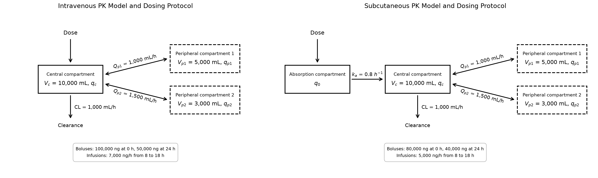

# PKModel_marks: Pharmokinetic Modelling Package 
PKModel_marks is a python package for solving and visualising pharmokinetic models.

The library supports both intravenous (IV) and subcutaneous (SC)
dosing, with optional peripheral compartments.

Both models support instantaneous bolus doses and constant-rate
infusions. Subcutaneous dosing introduces an additional absorption
compartment governed by the absorption rate constant `k_a` (Figure 1).



*Figure 1: Schematic of the compartments associated with intravenous (IV) and subcutaneous (SC) drug administration.*

## Package structure
```text
PK/
├── pkmodel/
|   ├── diagram.py
│   ├── model.py
│   ├── protocol.py
│   ├── solution.py
│   ├── version_info.py
│   └── tests/
│       ├── test_model.py
│       ├── test_protocol.py
│       └── test_solution.py
├── README.md
├── pyproject.toml
├── app.py
└── LICENSE
```

| Script | Description |
|-------|-------------|
| `Model` | Defines the model parameters and compartment structure. |
| `Protocol` | Defines whether the drug administration is continuous or instantaneous bolus as well as the times and amounts of dose delivery. |
| `Solution` | 	Solves the PK model with SciPy to find how the drug quantity changes over time across each compartment. Plots the solutions. |
| `Diagram` | Visualises a PK model and its dosing protocol as a compartment diagram. |

## Installing PKM

```python
python -m pip install PKModel_marks
```

## Requirements
```python
import numpy as np
import PKModel_marks as pk
import matplotlib.pyplot as plt
```

## Example

**1. Define the model**

For intravenous administration:
```python
model = pk.Model(
    V_c = 10_000,
    CL = 1_000,
    V_p = [5_000],
    Q_p = [1_000]
)
```

For subcutaneous administration, use the same model structure as above but specify a k_a parameter.

**2. Define the dosing protocol**

```python
protocol = pk.Protocol(
    boluses = [
        (0, 100_000),   # 100,000 ng at 0hr
        (12, 50_000)    # 50,000 ng at 12hr
    ],
    infusions = [
        (2, 4, 10_000) # 10,000 ng/hr from 2h to 4h (i.e. over the period [2,4))
    ]
)
```

**3. Solve the model and visualise**
```python
solution = pk.Solution(model, protocol).solve(
    t_span=(0, 24),
    t_eval=np.linspace(0,24,1000)
)

print(solution.t)
print(solution.y[0])
solution.plot("central")
solution.plot("peripheral_1")

plt.show()
```

## Interactive Demonstration 
Install the optional Streamlit dependency and launch the comparison app from
the repository root:
```powershell
pip install -e ".[app]"
streamlit run app.py
```

## Contributors
Developed as part of the Software Engineering model in the Doctoral Training Centre (DTC).
* Matt
* Adam
* Reefe
* Katie
* Saja
